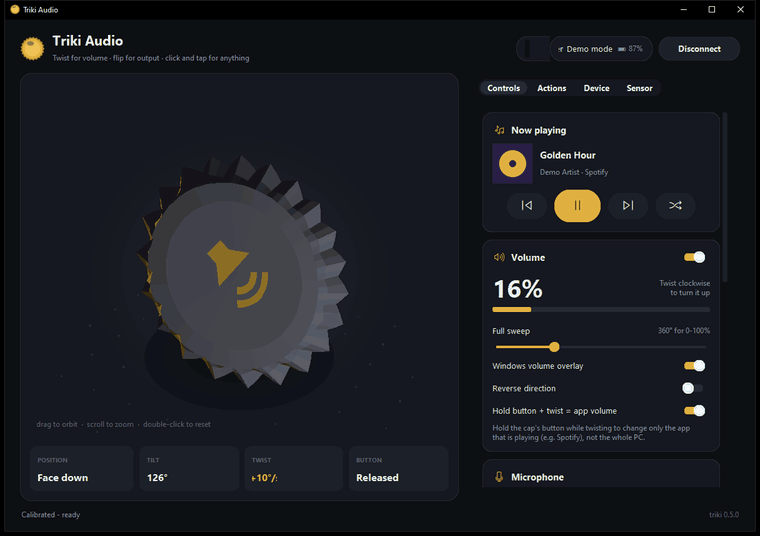
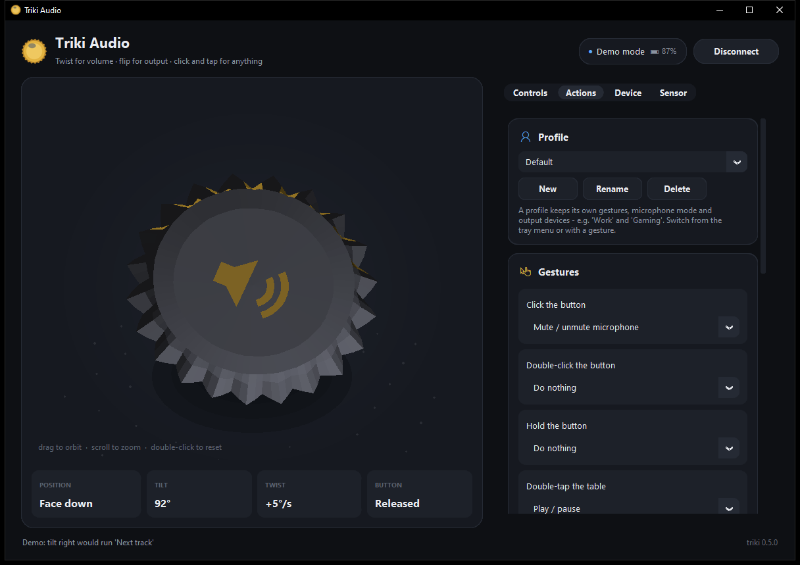

# Triki Audio

Turn the **Triki** bottle-cap controller into a desk audio remote for Windows.



| gesture | default |
|---|---|
| **twist** the cap clockwise / counter-clockwise | volume up / down (with the Windows volume overlay) |
| **hold the button + twist** | volume of just the app that's playing (e.g. Spotify) |
| **flip** it face up / face down | switch between two output devices (e.g. speakers ↔ headset) |
| **click** the button | play / pause |
| **double-click** the button | next track |
| **hold** the button | mute / unmute the microphone - or use **hold to talk** |
| **double-tap the table** next to it | previous track |
| **shake** it (firmly) | open Spotify in the browser |

Every click, tap and shake can be set to: mute the mic, play/pause,
next / previous track, shuffle, mute the speakers, switch output device,
switch profile, **any keyboard shortcut**, or **open an app or website**.

Also:

* **Now playing** - song, artist and album art from any player, with controls.
* **Profiles** - e.g. *Work* and *Gaming*, each with its own gestures, mic mode
  and output devices. Switch from the tray or with a gesture.
* **Battery level** of the cap in the window and tray, with a low-battery warning.
* **Sleep-aware** - when the cap dozes off, press its button and it's back in seconds.
* Runs in the **tray**, can **start with Windows**, shows a **"Muted" badge** while
  your mic is off.

> Unofficial. Not affiliated with the maker of the Triki. Built on the
> [triki-py](https://github.com/witw2/triki-py) library.



## Install

**Easiest:** download `TrikiAudio-windows.zip` from the
[latest release](https://github.com/witw2/triki-audio/releases/latest), unzip it
anywhere and run `TrikiAudio.exe`. No Python needed.

**From source** (Windows 10/11, Python 3.9+):

```bash
git clone https://github.com/witw2/triki-audio.git
cd triki-audio
pip install -r requirements.txt
python triki_audio.py
```

or double-click **`Triki Audio.pyw`** (no console window).

## First run

1. **Device** tab → **Scan**, pick your Triki, **Connect**.
2. Keep the cap still for a second while it calibrates (only needed once -
   the calibration is remembered).
3. **Controls** tab → pick an output device for *face up* and *face down*.
4. **Actions** tab → choose what clicks, taps and shakes do.

No cap at hand? **Device → Try demo** simulates one (your audio is left alone).

## Running in the background

* Closing the window hides it to the **tray** (the gold cap icon). Right-click
  it for quick controls, profiles, or **Quit**.
* **Device → Start with Windows** starts it hidden in the tray when you sign in.
* It remembers your Triki and reconnects automatically, also after the cap
  went to sleep (press the cap's button to wake it).
* Starting it a second time just brings the running window to the front.
* Windows hides new tray icons in the **^** overflow - drag the cap onto the
  taskbar to keep it visible.

## Tips

* **3D cap shows the wrong side up?** Toggle **Device → Sensor is upside down**.
* **Volume moves too fast or slow?** Controls → *Full sweep*.
* **Hold to talk:** Controls → Microphone → *Hold to talk*. You're muted except
  while the button is held. Other button gestures are paused in this mode.
* **Shake too easy or too hard?** Actions → *Shake force needed*.
* **Table taps too sensitive (or not enough)?** Actions → *Table taps* has a
  live meter: knock a few times and set *Knock needed* just below your knocks.
* **Pop-ups / muted badge:** Controls → *Notifications*.

Settings are stored in `%APPDATA%\TrikiAudio\config.json`.

## Developing

If [triki-py](https://github.com/witw2/triki-py) is checked out next to this
folder (`../triki-py`), the app uses that copy when the library isn't
installed.

Build the Windows app (also self-tests the result):

```powershell
powershell -ExecutionPolicy Bypass -File build.ps1
```

→ `dist\TrikiAudio\TrikiAudio.exe` and `dist\TrikiAudio-windows.zip`.
Pushing a tag such as `v1.0.0` builds the same zip on GitHub and attaches it to
a release.

```
triki_audio.py   app window, connection, gestures -> actions, profiles
actions.py       media keys, keyboard shortcuts, launching apps
media.py         now playing + media control (Windows media sessions)
cap_view.py      3D bottle-cap renderer and sensor charts
overlay.py       pop-up notifications and the "Muted" badge
tray.py          system-tray icon and menu
system.py        start with Windows, single instance, taskbar identity
theme.py         colours, fonts, icons
build.ps1        packaging with PyInstaller
```

## License

MIT
